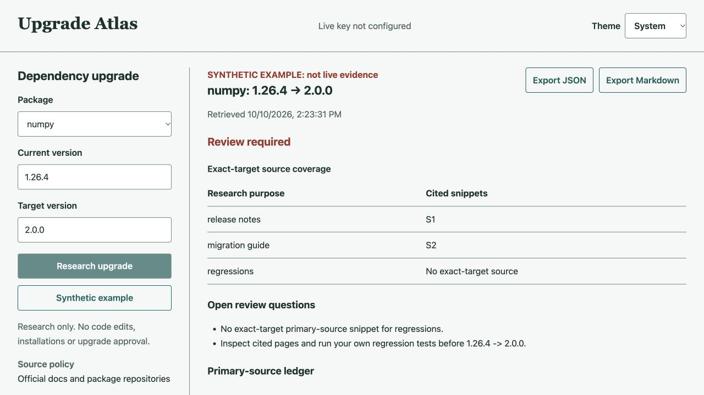

# Upgrade Atlas

Collect primary-source search evidence before reviewing a Python dependency
upgrade. SerpApi powers three purposeful searches: release notes, migration
guides and regressions. The tool rejects third-party lookalikes and unrelated
GitHub repositories, tracks exact target-version mentions, preserves search
provenance and exports an evidence packet with unresolved review questions.

## Current Verification

The local build has 64 passing tests, clear lint/format checks and a successful
wheel/source build. Native-browser QA covers desktop, 390px and 320px mobile,
light/dark text contrast and actual JSON/Markdown downloads. Real SerpApi API
access, demo recording and competition submission are **not yet verified**.
The synthetic example is invented test data and never becomes a fallback for a
failed live call. See [QA.md](QA.md) for the exact boundaries.



## Run

Python 3.11 or newer and [uv](https://docs.astral.sh/uv/) are required.

```sh
uv sync --group dev
uv run upgrade-atlas example
uv run upgrade-atlas serve --port 8872
```

The interface is local-only at `http://127.0.0.1:8872`. Without a server-side
`SERPAPI_API_KEY`, live research is unavailable and explicitly disabled. Obtain a
free account directly from SerpApi; do not add a card or paid plan for this build.
Set the key through a private environment mechanism, never a command-line argument
or source file. Then run:

```sh
uv run upgrade-atlas research numpy 1.26.4 2.0.0 --format json
```

The supported packages are NumPy, Pydantic, Django and SQLAlchemy. Current and
target versions are user-supplied, not asserted to be the latest or released.
The verified source boundary is configured in `catalog.py`.

## Evidence Contract

- Only Google organic results returned through SerpApi are considered.
- Each research packet makes at most three provider calls. Identical queries are
  cached per process. The local process budget is twelve calls, not a provider
  quota or durable monthly budget. Restarts reset it.
- No pagination, automatic retries, paid top-ups or key rotation.
- Searches return snippets, not full-page inspections. Exact target mentions are
  literal matches, not a compatibility score or proof of release existence.
- The verdict is always `REVIEW REQUIRED`. Empty results do not imply zero bugs.
- Result pages are not fetched or executed. Source excerpts are untrusted data.
- Source matching is a host/repository boundary, not proof of document accuracy.
- No dependency installation, code modification, regression execution or release
  approval is performed.
- JSON exports retain per-query observations, so one target match cannot silently
  establish coverage for unrelated research purposes.

## Security and Cost

The server binds only to loopback, rejects unexpected Host/Origin values, accepts
bounded JSON input and avoids raw provider URLs/errors in exported data. The key
stays server-side. The known key is redacted from provider results. Query strings
and fragments are removed from result URLs. This is a local tool, not a hardened
public multi-user service. Search terms and API requests are processed by SerpApi
under its terms. Raw provider datasets and secrets do not belong in public git.

## Test

```sh
uv run pytest -q
uv run ruff check .
uv run ruff format --check .
uv build
```

Unit tests use mocked or explicitly synthetic provider data. They are not evidence
of a real SerpApi request. The live integration and screen recording are separate
release gates.

## Attribution and AI Disclosure

Original project code was developed with OpenAI Codex assistance for architecture,
coding, tests and documentation. No claim of independent personal code review is
made. No LLM is used at runtime. Dependencies retain their licenses. Search data
remains third-party material, not the project's own documentation.

Primary references: [Google Search API](https://serpapi.com/search-api),
[organic-result schema](https://serpapi.com/organic-results), and
[competition rules](https://serpapi.github.io/serpapi-india-hackathon-2026/rules.html).
